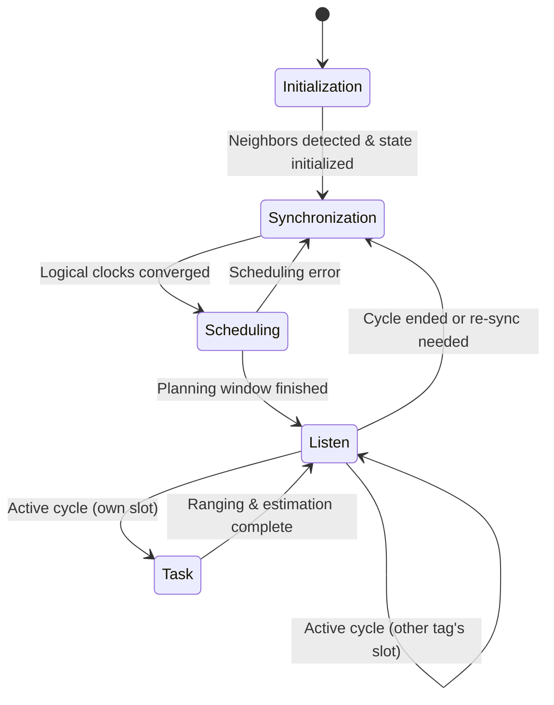

# CLAMOUR

**Collaborative Localization Adapted from Modular Onboard UWB Ranger**

CLAMOUR is a collaborative localization system designed to power self-localizing audioguides for the [Chambord Castle Museum](https://www.chambord.org/en/discovering/the-castle-visit/) exhibition. Based on a visitor's real-time position within the castle, the audioguide dynamically generates adaptive music.

An initial prototype was developed in 2018. Further details on the prototype and underlying research are available in the [arXiv paper (1905.03247)](https://arxiv.org/abs/1905.03247).

This project is a joint collaboration by the following laboratories:
- **MIST lab** - Polytechnique Montréal
- **NXI Gestatio** - UQAM
- **INIT Robots** - ETS.
---

## Table of contents
-[Overview & Key Concepts](#overview--key--concepts)
-[System Architecture & Communication Cycle](#system-architecture-communication--cycle)
-[Docker Deployement](#docker-deployement)
---

## Overview & Key concepts

The primary objective of CLAMOUR is to achieve **collaborative localization and tracking with minimal fixed infrastructure**

**UWB (Ultra-WideBand)**
UWB is a radio technology used here to measure distances between devices. These mesurements are then used to estimate positions. 

**Anchor**
An anchor is a fixed reference point whose position is know. A device can measure its distance to an anchor to obtain information about its localisation. 

**Tag (mobile device)**
a tag is a UWB device that the the system aims to localize. it can also communicate with neighboring tags and contribute to their localization.

**TDMA (Time-Division Multiple Access)**
A channel access method where time is divided into discrete slots. Each tag transmits only during its assigned slot to prevent radio collisions with neighboring devices.
---
## System Architecture & Communication Cycle

Each node operates as a state machine structured around a synchronized TDMA cycle : 

Step 1 - Initialization
The device first start to wait a random delay, then attempt to detect other tags around itself. It then update itself and switch to the next state
Step 2 - Synchronisation
This state prepares the tag for synchronization by converging the logical clock of the tags so that they can coordonnate their transmissions. Afte the preparations are done, the device switches to the Scheduling state

Step 3 - Scheduling
This state attributes slots for each tag using the temporal informations prepared during the synchronization state. When the planification windows is finished, it switches to the Listen state. If an error message is returned, it switches to the Synchronization state.

Step 4 - Listen
This state can be divided in four different outcomes. If a re-synchronisation is needed, the device switches to the Synchronisation state. If the TDMA cycle is over, it also switches to the Synchronization state. If were in the cycle and the current slot is owned by the device, it switch to the Task state. Finally, if were in the cycle but the current slot is not owned by the device, it stays in the Listen state.

Step 5 - Task
This is the step start by discovering periodically the other devices. It also cleans the obsolete informations by the mean of a garbage collector. After the other tags have been discovered, the program starts mesuring distances between devices and transmit the result. If the surrondings have changed, the device sends a message to the other devices about the change and then updates the logical clock and the delay with the surrounding device. The distance estimatior receives : 
- the distance mesured between the device and the anchors
- the distance mesured between the device and the other tags
- the logical clock and the delay
- the known topologic of the network

---
## Docker Deployement

A Dockerfile is provided to run CLAMOUR inside a container.
Containerization ensures consistent dependencies and static configurations across a cluster of Raspberry Pi nodes without configuration drift
---
## Running the container 
Because CLAMOUR communicates with a Pozyx UWB transceiver over USB, you must pass the host's serial device to the container using the --device flag. On linux/Raspberry Pi, this device is typically /dev/ttyACMO (Verify the exact port on your node usiing ls /dev/ttyACM*).

`docker run --device=/dev/ttyACM0 clamour`
(Replace /dev/ttyACM0 with your node's actual USB device path and `clamour` with your built image name if different.)